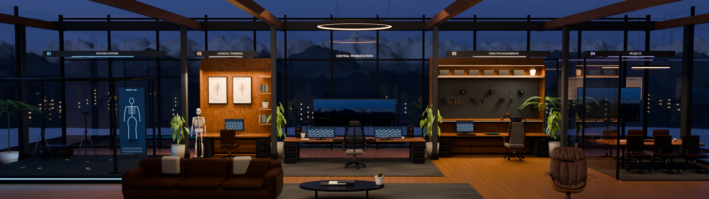

# Kinetic Studio

Editable four-zone Blender studio with warm interior lighting, a blue-hour mountain exterior, an adaptive browser tour, and a separate experimental Gaussian reconstruction.



## Open the project

- **Editable master:** [kinetic-studio-proof-v006.blend](work/kinetic-blender/kinetic-studio-proof-v006.blend), authored and reopened with Blender 4.5.3. Geometry, text, shaders, modifiers, lights, five cameras, and 20 packed file images remain editable.
- **Browser tour:** [work/kinetic-tour](work/kinetic-tour). Workstation/Home and all four zones have image views, optional baked 3D, smooth camera transitions, keyboard navigation, and reduced-motion support.
- **Gaussian pilot:** [work/kinetic-splat](work/kinetic-splat). The native SuperSplat `.ssproj`, compressed `.sog`, trained PLY, and inspection evidence are included. The pilot remains experimental.
- **Proof renders:** the master overview is 3840 × 1080. Four zone renders are 1600 × 1000 beside the Blender source.

The Blender master uses Git LFS. Install Git LFS before cloning, or run these commands after cloning:

```sh
git lfs install
git lfs pull
```

## Run the tour locally

Use Node.js 24.19 or a compatible version supported by the pinned Vite release.

```sh
cd work/kinetic-tour
npm ci
npm run build
npm run preview
```

Open `http://127.0.0.1:4177/`. The experimental reconstruction is at `/pilot.html`; `/pilot.html?sog` uses the compressed export. Windows users can run `start-tour.cmd` after dependency installation. The app has no backend or account requirement.

## Verify

From `work/kinetic-tour`:

```sh
npm test
node tests/validate-models.mjs
npm run build
```

The delivery manifest at [work/kinetic-studio-delivery.json](work/kinetic-studio-delivery.json) records byte counts and SHA-256 hashes for ten primary artifacts. Existing browser, Blender, and reconstruction acceptance receipts are included. Browser regression requires the separately installed `agent-browser` CLI and a running loopback preview.

## Publication scope

This repository includes the current v006 master, published assets, source scripts, supplied concept references, provenance, and selected verification evidence. Earlier binary checkpoints, raw asset downloads, the 144-image reconstruction dataset, training intermediates, local runtimes, caches, and dependency folders remain in the original local workspace.

The incremental Blender scripts preserve the historical build process; some require omitted v001–v005 checkpoints and downloaded assets. `verify_kinetic_studio.py` also compares those historical checkpoints and raw asset hashes. Its included receipts describe the original full workspace. A clean clone can open and edit the packed v006 master, run the browser tour, validate its GLBs, and inspect the native reconstruction without those archives. Rebuilding the entire historical pipeline or recomputing held-out reconstruction metrics requires the omitted inputs.

## Provenance and limits

Six Poly Haven CC0 assets provide scanned foliage, a lounge chair, material response, and a dusk HDRI. Sources, authors, and hashes are in [asset-provenance.json](work/kinetic-blender/assets/asset-provenance.json). Concept references are supplied project inputs; this repository does not grant additional rights to those references or third-party marks. No blanket license is asserted for the project.

The camera fit is inferred. Terrain, anatomy, screen data, and prototypes are illustrative. Web lighting is baked and approximates Cycles; live light editing remains in Blender. The single-zone Gaussian pilot retains thin-edge and display artifacts. Physical-phone frame rate, sustained device performance, final photographic acceptance, and the previously failing Windows Blender GUI launcher remain unverified. Git publication does not deploy a website.
